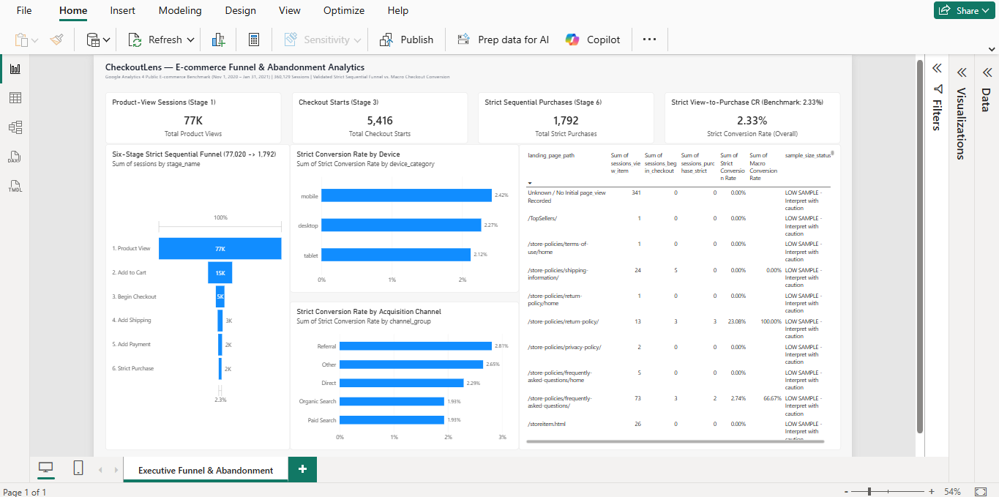

# CheckoutLens — E-commerce Funnel & Abandonment Analytics

CheckoutLens is an end-to-end data analytics project that analyses the e-commerce customer journey, identifies funnel drop-offs, and compares conversion performance across devices, acquisition channels, countries, and landing pages.

The project combines SQL, Python, Pandas, and Power BI to transform event-level data into actionable business insights.

## Tools & Technologies

- **SQL & Google BigQuery** — Event analysis, session-level funnel construction, segmentation, and data validation.
- **Python & Pandas** — Data processing, analysis, metric validation, and conversion-lift scenario analysis.
- **Jupyter Notebook** — Reproducible analytical workflow.
- **Microsoft Power BI** — KPI cards, funnel visualisation, conversion comparisons, and landing-page performance reporting.

## Key Features

- Six-stage chronological e-commerce funnel analysis.
- Strict sequential conversion and macro checkout-to-purchase analysis.
- Device, acquisition-source, country, and landing-page segmentation.
- Data-quality checks and reconciliation of segment totals against global funnel counts.
- Conversion-rate comparisons and landing-page performance analysis.
- Hypothetical conversion-lift sensitivity analysis to explore potential business impact.

## Dataset

The analysis uses Google's public **GA4 Sample Ecommerce** dataset in BigQuery.

- **Period:** November 1, 2020 – January 31, 2021
- **Source:** [Google Analytics — BigQuery ecommerce sample dataset](https://developers.google.com/analytics/bigquery/web-ecommerce-demo-dataset)

## Key Findings

| Funnel Stage | Sessions |
|---|---:|
| Product views | 77,020 |
| Add to cart | 15,167 |
| Begin checkout | 5,416 |
| Add shipping information | 3,119 |
| Add payment information | 2,438 |
| Strict sequential purchases | 1,792 |

**Strict view-to-purchase conversion: 2.33%**

Key observations:

- The largest absolute drop-off occurs between product views and cart additions, with **61,853 fewer sessions**.
- Between checkout start and shipping information, **2,297 sessions are lost**, representing a 42.41% drop from checkout starts.
- Conversion rates vary across devices, acquisition sources, countries, and landing pages.

These are observational findings. They identify areas for further investigation but do not establish the causes of customer abandonment.

## Dashboard Preview

The Power BI dashboard presents the main funnel KPIs, six-stage funnel, device conversion comparison, acquisition-channel performance, and landing-page metrics.



## Methodology

1. Construct session-level event sequences using user and session identifiers.
2. Apply chronological ordering to measure progression through the six funnel stages.
3. Calculate strict sequential conversion separately from macro checkout-to-purchase conversion.
4. Analyse performance across device, first-user acquisition source, country, and landing-page segments.
5. Validate data quality and reconcile segment-level counts with global funnel results.
6. Use Python and Pandas for additional analysis and hypothetical conversion-lift scenarios.
7. Present the findings through a Power BI dashboard.

## Limitations

- The dataset is a historical sample and may not represent current e-commerce behaviour.
- The analysis is observational; conversion differences do not prove causation.
- Traffic-source fields represent first-user acquisition attribution rather than session-level attribution.
- Segment conversion rates should be interpreted alongside their sample sizes.
- The landing-page analysis uses a different session population from the funnel-event analysis.
- Conversion-lift scenarios are hypothetical and depend on stated assumptions; they are not forecasts.

## Project Structure

```text
checkoutlens/
├── sql/
│   ├── 01_data_audit.sql
│   ├── 02_funnel_analysis.sql
│   └── 03_segment_analysis.sql
├── notebooks/
│   └── checkoutlens_analysis.ipynb
├── data/
│   ├── 05_device_segment_funnel.csv
│   ├── 06_traffic_channel_funnel.csv
│   ├── 07_country_segment_funnel.csv
│   ├── 08_landing_page_funnel.csv
│   └── README.md
├── powerbi/
│   ├── CheckoutLens.pbix
│   ├── CheckoutLens.pbip
│   └── README.md
├── screenshots/
│   └── dashboard.png
├── requirements.txt
├── .gitignore
└── README.md
```

## Author

**Dhruv Agarwal**
